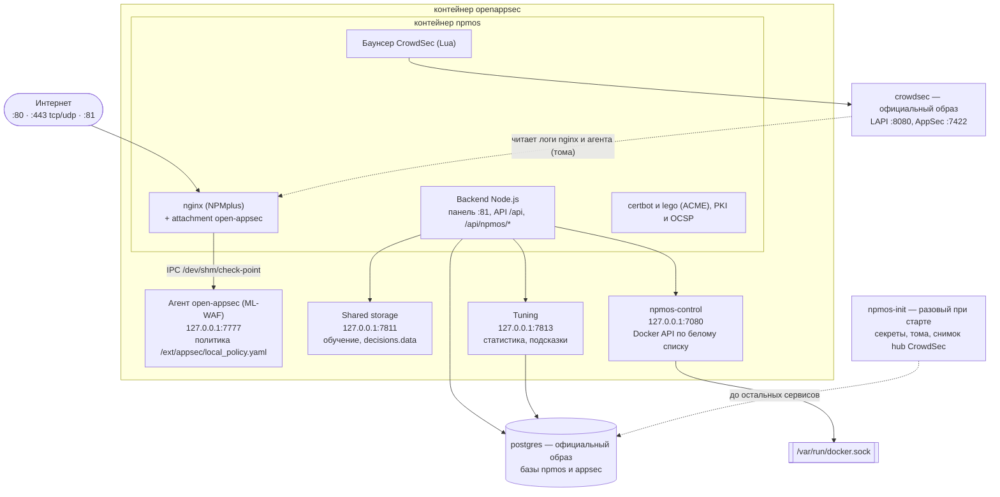
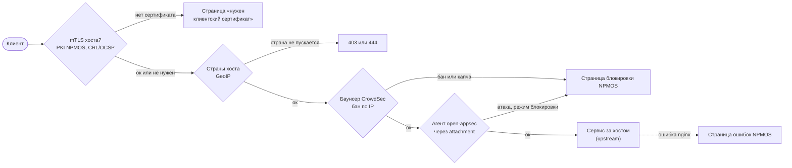
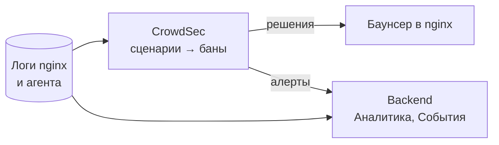

# Правила участия в NPMOS

Этот документ — для всех, кто пишет в issues, предлагает изменения или помогает с проектом. В нём четыре части:
как общаться, как оформлять баги, фичи и вопросы, как устроен NPMOS и что где лежит в репозитории.

## 1. Как общаться

- Уважительно и по делу. Критикуем код и решения, а не людей.
- Без оскорблений, травли, дискриминации по любому признаку, публикации чужих личных данных.
- Помогаем новичкам: вопрос «как это работает» — нормальный вопрос.
- Спорные решения обсуждаем аргументами: что ломается, на какой версии, как воспроизвести.
- Сопровождающие проекта могут скрыть или удалить сообщение, которое нарушает эти правила, а при повторных
  нарушениях — ограничить участие. Жалобы — через issue с меткой `conduct` или напрямую сопровождающим.

## 2. Как оформлять issue

Перед созданием: поищите похожее в открытых и закрытых issues, проверьте [docs/TROUBLESHOOTING.md](docs/TROUBLESHOOTING.md)
и [docs/CHECKLIST.md](docs/CHECKLIST.md). Одна проблема — одно issue. Шаблоны есть в «New issue».

### Баг

Заголовок — что сломано и где: «Сертификаты: выпуск через ACME (lego) падает с 401 на ТЦИ stage».

```text
Версия:        тег образа (develop / X.Y.Z) или коммит; docker compose -f deploy/compose.yaml images
Окружение:     ОС хоста, Docker/Compose, IPv4/IPv6, есть ли интернет у сервера
Что делал:     шаги по порядку, с разделом интерфейса (например «Сертификаты → Добавить → ACME»)
Ожидал:        что должно было произойти
Получил:       что произошло; текст ошибки целиком
Логи:          «Обзор → Сервисы → <сервис> → Логи» или «Сертификаты → Полный лог последнего запроса»,
               либо «Обзор → Сервисы → Диагностический архив» (пароли и ключи в нём скрыты)
Скриншоты:     если проблема в интерфейсе
```

Не прикладывайте пароли, токены, закрытые ключи, ключи EAB. Диагностический архив маскирует их, но проверьте его
перед отправкой.

### Уязвимость

Не публикуйте её в issue. Сообщите закрыто: Security → Report a vulnerability на GitHub (или лично сопровождающим,
контакт в профиле организации) и опишите, как воспроизвести; публичное issue создадим после исправления. Подробно —
`SECURITY.md`.

### Фича (предложение)

Заголовок — что должно появиться: «ACME: импорт аккаунта, зарегистрированного в другом клиенте».

```text
Задача:        какую проблему решает (не «добавьте кнопку», а «мне нужно …, сейчас приходится …»)
Как вижу:      где в интерфейсе и как работает; пример
Альтернативы:  что уже пробовали
Принципы:      работает ли без интернета; настраивается ли из GUI (см. раздел 3: оба правила обязательны)
```

Предложение, которое требует ручной правки compose, `cscli`, `open-appsec-ctl` или облачной консоли, примем
только вместе с тем, как это вынести в интерфейс.

### Вопрос

Метка `question`. Опишите, что хотите сделать и что уже прочитали. Ответ, который стоит знать всем, попадёт в
документацию.

### Метки

`bug`, `feature`, `question`, `security`, `docs`, `conduct`; область: `acme`, `waf`, `crowdsec`, `pki`, `hosts`,
`ui`, `deploy`. Сопровождающие ставят их при разборе.

## 3. Архитектура NPMOS

Два правила проекта: **всё управляется через GUI** и **ничего не зависит от облака** (интернет — только опция,
которую включает администратор: ACME, обновления hub CrowdSec и т. п.). Правила разработки — в
[CONTRIBUTING.md](CONTRIBUTING.md) и [CLAUDE.md](CLAUDE.md).

### Контейнеры

Стек описан в `deploy/compose.yaml`. Контейнер `openappsec` владеет сетью и IPC: порты опубликованы на нём, а
`npmos` подключается к его сети (`network_mode: service:openappsec`), поэтому сервисы обоих общаются через
`127.0.0.1`.



- **Сети.** `edge` — порты наружу; выход в интернет только для того, что включил администратор (ACME). `internal` —
  без выхода наружу: там `crowdsec` и `postgres`.
- **Секреты.** Их создаёт `npmos-init` в томе `secrets`; каждый сервис монтирует только свой подкаталог.
- **Доступ к Docker** есть только у `npmos-control`: список, логи и перезапуск контейнеров стека, с токеном и
  аудитом. Контейнер `npmos`, который принимает трафик из интернета, сокета не получает.

### Путь запроса



Логи nginx и агента читают два потребителя: CrowdSec (сценарии и баны) и backend (Аналитика и События).



## 4. Дерево файлов

Что лежит в репозитории и зачем. Код NPMOS расписан по файлам, код NPMplus (upstream, `git subtree`) — по
каталогам: в его файлах наши правки помечены комментарием `NPMOS:`. Тесты (`*.test.js`, `*.test.ts`) лежат рядом
с тем, что проверяют, и в дереве не перечислены. Добавили, переименовали или удалили файл — поправьте дерево: CI (`scripts/check-tree.mjs`) проверяет, что каждый
файл кода NPMOS в нём упомянут.

### Корень

- `README.md` — что такое NPMOS, установка, ссылки на документацию
- `CODE_OF_CONDUCT.md` — этот файл: правила общения, issue, архитектура, дерево файлов
- `CONTRIBUTING.md` — как вносить изменения: ветки, коммиты, проверки
- `CLAUDE.md` — правила разработки (для людей и ИИ-агентов): структура, проверки, правки upstream
- `SECURITY.md` — политика безопасности: как сообщить об уязвимости, какие версии поддерживаются
- `renovate.json` — автообновление версий образов и зависимостей (Renovate)
- `.semgrepignore` — что Semgrep не проверяет (зависимости, сборка, переводы, тесты)
- **`.github/`**
  - `workflows/ci.yml` — CI: быстрые проверки на каждый push; полный прогон (сборка образов, закрытый контур, скан
    образов, DAST, отчёт безопасности, публикация на Docker Hub) на `work`, тегах, PR, `security/**`, `[full]`
  - `workflows/security-weekly.yml` — каждую неделю: ветка `security/<дата>` от `work`, полный CI на ней, issue с
    отчётом, удаление веток старше 8 недель
  - `workflows/training.yml` — обучение модели WAF: ветки `training/**`, `[train]` в коммите или кнопка; модель,
    её карточка и сравнение со штатной — в артефакте `waf-model` (`docs/MODEL.md`)
  - `workflows/security.yml` — DevSecOps: SAST, секреты, SCA и SBOM исходников, IaC, workflow, качество кода;
    в еженедельном прогоне — ещё и опубликованные образы (`docs/DEVSECOPS.md`)
  - `actionlint.yaml` — настройки actionlint (метки раннеров)
  - **`security/`** — настройки сканеров
    - `tools.env` — образы и версии всех сканеров, закреплённые по digest
    - `semgrep.yml` — правила Semgrep для NPMOS: таймауты запросов, shell, сырой HTML, SQL из шаблонов
    - `gitleaks.toml` — Gitleaks: стандартные правила и места с примерами вместо секретов
    - `codeql.yml` — CodeQL: что не код продукта
    - `hadolint.yaml` — hadolint: отключённые правила с причинами
    - `licenses.txt` — лицензии зависимостей, не требующие проверки
    - `accepted-risks.json` — принятые риски: находки, которые не блокируют, с причиной и сроком
  - `ISSUE_TEMPLATE/` — шаблоны issue: `bug.yml`, `feature.yml`, `question.yml`, `config.yml`

### `deploy/` — запуск стека

- `compose.yaml` — прод-стек: `npmos`, `openappsec`, `crowdsec`, `postgres` и разовый `npmos-init`
- `compose.dev.yaml` — надстройка для разработки: dev-образ, синхронизация backend, генератор атак
- `.env` — закреплённые версии образов и реестр
- **`init/`**
  - `npmos-init.sh` — разовый старт: секреты, каталоги томов, офлайн-снимок hub CrowdSec
  - `postgres-init.sh` — базы и пользователи postgres при первом запуске
- **`openappsec/`** — образ `npmos-openappsec`
  - `Dockerfile` — агент open-appsec (C++), shared storage и tuning (Go) из исходников, `npmos-control`
  - `npmos-openappsec.sh` — запуск процессов контейнера: агент, shared storage, tuning, `npmos-control`
  - `sources.env` — коммиты исходников open-appsec, из которых собирается образ
  - `agent/npmos-entry.sh` — настройки агента из GUI (WAF → Агент) при каждом его старте
  - `agent/merge-headers.py` — добавляет заголовки из `waap-headers.json` в сигнатуры агента при сборке
  - `agent/waap.data` — модель агента в образе: продвинутая модель Check Point («Advanced model, V2.0», лицензия внутри файла)
  - `agent/waap-headers.json` — заголовки браузеров (`Sec-Fetch-*`, `Priority`…) со строгими шаблонами значений, чтобы агент не принимал их за атаку
  - `agent/patches/` — патчи агента: только локальный режим, без облака; лимиты для хостов без схемы и с портом, правила лимитов локальной политики (без `action` и `match`);
    выгрузка признаков модели для обучения (только на стенде обучения, `docs/MODEL.md`)
  - `go-service/patches/` — патч tuning: пароль базы не пишется в лог
- **`test/`** — закрытый контур, DAST, стенд обучения модели
  - `compose.airgap.yaml` — стек без выхода в интернет
  - `smoke.sh` — сценарии проверки всех функций на этом стеке
  - `compose.dast.yaml` — стек для DAST: сайт за прокси-хостом и контейнер настройки
  - `dast-setup.sh` — настройка стека для DAST как в GUI: админ, сертификат PKI, прокси-хост с TLS
  - `compose.training.yaml` — стенд обучения модели WAF: сайт за прокси-хостом, выгрузка признаков агента
  - `fixtures/npm-backup.tgz` — резервная копия NPM для проверки переноса
- **`dev/`**
  - `Dockerfile` — быстрый dev-образ: upstream-образ NPMplus + наш backend и rootfs
  - `attack.sh` — генератор обычных и вредоносных запросов для проверки WAF

### `scripts/` — инструменты разработчика

- `build-images.sh` — локальная сборка всех образов (тег `local/<имя>:dev`)
- `test-airgap.sh` — тест закрытого контура: поднимает стек без интернета и прогоняет `smoke.sh`
- `check-i18n.mjs` — проверка CI: у каждой строки `en` есть `ru`, в разметке нет текста мимо переводов
- `crowdsec-hub-snapshot.sh` — снимок hub CrowdSec для серверов без интернета
- `gen-world-map.mjs` — генерация `worldMap.json` (контуры стран для карты Аналитики)
- `check-tree.mjs` — проверка CI: каждый файл кода NPMOS упомянут в этом дереве
- `scan-images.sh` — скан образов: уязвимости и секреты (Trivy), SBOM (Syft), второе мнение (Grype), CIS (Dockle)
- `test-dast.sh` — DAST: поднимает стек и атакует его (OWASP ZAP, Nuclei, testssl.sh), проверяет nginx (gixy)
- `security-report.mjs` — сводный отчёт безопасности, политика блокировки, читаемые страницы SBOM
- `train-model.sh` — цикл обучения модели WAF на настоящем агенте: штатная модель, обучение, установка новой как
  в GUI, сравнение и решение о выпуске (`docs/MODEL.md`)

### `model/` — обучение модели WAF (`docs/MODEL.md`)

- `datasets.py` — размеченный набор запросов (WAF Comparison Project, ложные срабатывания mgm, свои случаи) и
  деление на обучение и проверку по сайтам и полезным нагрузкам
- `replay.py` — отправляет набор через стек: у каждого запроса свой id и свой источник; записывает решения агента
- `waapmodel.py` — формат модели агента (`waap.data`) и её оценка, вычисленная так же, как в агенте
- `train.py` — обучение: разреженная логистическая регрессия по признакам агента, порог, `waap.data` и `.tgz`
- `evaluate.py` — сравнение со штатной моделью по решениям агента, проверка совпадения оценок, решение о выпуске
- `requirements.txt` — numpy и scipy для обучения
- `test_model.py` — тесты: формат, данные, полный цикл на синтетике

### `docs/` — документация

- `MIGRATION.md` — перенос с Nginx Proxy Manager, NPMplus и open-appsec-npm
- `TROUBLESHOOTING.md` — решение проблем
- `UNINSTALL.md` — полное удаление NPMOS
- `ENV-INVENTORY.md` — какие env-настройки остались и когда уходят в GUI
- `TESTING-DEVELOP.md` — как развернуть develop-версию и что проверить руками
- `CHECKLIST.md` — полная проверка всех функций
- `DEVSECOPS.md` — проверки безопасности в CI: сканеры, политика блокировки, отчёт, SBOM, принятые риски
- `MODEL.md` — модель WAF NPMOS: как устроена модель open-appsec, данные, обучение, проверка, выпуск
- `ROADMAP.md` — план разработки по фазам
- `LEARNING-RESEARCH.md` — исследование обучения агента open-appsec (перед фазой 8)
- `tutor.md` — черновик статьи об open-appsec
- `adr/` — архитектурные решения: сеть (0001), RBAC (0007), политика WAF (0008), PKI и mTLS (0009), CrowdSec (0010), обучение (0011)

### `npmos/` — образ npmos (NPMplus + NPMOS)

- `Dockerfile` — образ npmos: nginx, attachment open-appsec и модули из исходников, lego, офлайн-сид CrowdSec
- `README.md` — что лежит в каталоге
- `crowdsec-seed/` — сборка офлайн-снимка hub CrowdSec, который кладётся в образ
- `patches/` — патчи nginx и его модулей
- **`rootfs/`** — файлы, которые копируются в образ как есть
  - `usr/local/bin/` — `start.sh` (настройка и запуск при старте контейнера), `launch.sh`, `entrypoint.sh`, `healthcheck.sh` и другие скрипты NPMplus
  - `usr/local/nginx/conf/nginx.conf` — главный конфиг nginx, в том числе формат лога запросов `npmos_requests`
  - `usr/local/nginx/conf/conf.d/npmos-block-page.conf` — страница блокировки NPMOS для отказов 403
  - `usr/local/nginx/conf/conf.d/npmos-crowdsec-hub.conf` — локальная раздача снимка hub CrowdSec
  - `usr/local/nginx/conf/conf.d/npmos-geo.conf` — страны по GeoIP (переписывается backend при загрузке базы)
  - `usr/local/nginx/conf/conf.d/npmos-mtls-log.conf` — лог отказов mTLS
  - `usr/local/nginx/conf/conf.d/npmos-ocsp.conf` — проверка клиентских сертификатов через OCSP NPMOS
  - `usr/local/nginx/html/npmos-error.html` — страница ошибок nginx в дизайне NPMOS
  - `usr/local/nginx/html/npmos-mtls-denied.html` — страница «нужен клиентский сертификат»
  - `usr/local/lua/npmos/npmos_block_page.lua` — подстановка настроек в страницу блокировки
  - `usr/local/lua/npmos/npmos_error_page.lua` — подстановка кода и текста в страницу ошибок
  - `etc/npmos/crowdsec-ban.html`, `crowdsec-captcha.html` — страницы бана и капчи баунсера CrowdSec
- **`backend/`** — API на Node.js
  - `index.js` — запуск: миграции, затем `bootstrap` модулей NPMOS (ACME, WAF, PKI, CrowdSec, GeoIP…), фоновые задачи
  - `internal/`, `routes/`, `lib/`, `models/`, `templates/` — код NPMplus: логика хостов, маршруты API, шаблоны конфигов nginx; наши крючки помечены `NPMOS:`
  - **`npmos/`** — модули NPMOS
    - `routes.js` — все маршруты `/api/npmos/*`
    - `settings.js` — настройки NPMOS в таблице `npmos_setting`
    - `secrets.js` — шифрование секретов в базе (пароли SMTP, ключи webhook, токены ботов)
    - `redact.js` — маскировка секретов в тексте, который уходит наружу (диагностический архив)
    - `services.js` — Обзор → Сервисы: контейнеры стека через `npmos-control`
    - `hosts.js` — таблица Хостов: кто и когда менял хост, состояние upstream
    - `certificates.js` — Сертификаты → реестр всех сертификатов системы с серверными страницами
    - `cert-terms.js` — сроки TLS-сертификатов хостов и когда пора обновлять
    - `cert-pair.js` — загруженный сертификат и ключ должны подходить друг к другу
    - `pem.js` — сертификаты из PEM-текста за один проход (без регулярных выражений, медленных на подложенном файле)
    - `files.js` — чтение файла вместе с его stat через один дескриптор (файл не подменить между проверкой и чтением)
    - `acme.js` — certbot для ACME-сервера из настроек (регистрация аккаунта, EAB)
    - `acme-csr.js`, `acme-csr-check.js` — выпуск по своему CSR и проверки этого CSR
    - `block-page.js` — Агенты → Страница блокировки: настройки и файл страницы
    - `stream-ports.js` — один входящий порт (диапазон) на протокол у потоков
    - **`acme/`** — `servers.js` (ACME-серверы: пресеты и свои, EAB), `lego.js` (второй ACME-клиент), `certs.js` (сертификаты NPMplus с сервером из настроек)
    - **`audit/`** — `index.js`: журнал аудита со страницами и фильтрами
    - **`control/`** — `server.js` (сервис `npmos-control`: доступ к Docker по белому списку), `client.js` (клиент backend), `watchdog.js` (чинит контейнеры, делящие сеть с другим)
    - **`crowdsec/`**
      - `index.js` — CrowdSec в GUI: обзор, решения, алерты, машины, баунсеры, метрики
      - `lapi.js` — клиент локального API CrowdSec (LAPI)
      - `config.js` — генерация файлов CrowdSec из настроек
      - `apply.js` — применение настроек: файлы, нужные элементы hub, перезапуск, откат при ошибке
      - `hub.js` — hub без `cscli`: индекс, установка и удаление элементов
      - `bouncer.js` — Lua-баунсер в nginx, настраиваемый из GUI
      - `alerts.js` — алерты CrowdSec → общая лента событий
      - `blocklists.js` — локальные блок-листы вместо облачного списка сообщества
      - `lists.js` — разбор и проверка списков IP и CIDR
    - **`events/`** — события и аналитика
      - `ingest.js` — фоновый приём: лог агента open-appsec, лог запросов nginx, обслуживание таблиц
      - `tail.js` — чтение того, что агент дописал в лог с прошлого раза
      - `normalize.js` — запись лога агента → строка события
      - `store.js` — хранение: дневные разделы, агрегаты, срок хранения
      - `index.js` — Аналитика → События: фильтры, страницы, общая лента «Все»
      - `feed-filters.js` — фильтры запросов в ленте «Все» (статус, исход, клиент)
      - `requests.js` — JSON-лог запросов nginx → таблица запросов и почасовые итоги
      - `client.js` — кто сделал запрос: человек, бот или сканер
      - `useragent.js` — браузер, ОС и тип устройства по User-Agent
      - `traffic.js` — вкладки Аналитики: запросы, посетители, производительность, безопасность, кэш, серверы
      - `analytics.js` — графики атак (open-appsec и CrowdSec)
    - **`geo/`** — `index.js`: страны хоста (пускать только эти или не пускать эти) для шаблонов nginx
    - **`geoip/`** — `index.js` (база GeoIP: встроенная или загруженная в GUI), `mmdb.js` (чтение файлов .mmdb)
    - **`learning/`** — обучение агента open-appsec
      - `index.js` — очередь неуверенных решений, разметка, готовность хостов
      - `model.js` — чистые функции обучения (без базы)
      - `appsec.js` — клиенты shared storage и tuning
      - `policy.js` — исключения из разметки в политике (мгновенный эффект)
    - **`migration/`** — перенос из NPM, NPMplus и open-appsec-npm
      - `index.js` — порядок переноса и отчёт
      - `source.js` — что лежит в резервной копии и где
      - `tar.js` — чтение tar-архива
      - `schema.js` — приведение старой базы к схеме NPMOS
      - `copy.js` — копирование строк в базу NPMOS
      - `files.js` — копирование файлов в `/data`
    - **`notifications/`** — `index.js` (каналы, правила, движок проверки), `rules.js` (что проверяется и текст сообщений), `channels.js` (отправка: email, webhook с HMAC, Telegram)
    - **`pki/`** — свой PKI и mTLS
      - `index.js` — CA, выпуск, отзыв, CRL, OCSP, ссылки на скачивание
      - `mtls.js` — mTLS хостов и потоков: доверенные CA, правила, файлы для nginx
      - `trust.js` — чистые функции mTLS: набор доверенных CA, правила по полям сертификата
      - `ops.js`, `openssl.js` — операции X.509 через системный openssl
      - `x509.js` — проверка субъектов и имён, конфиги openssl, серийные номера
      - `denials.js` — отказы mTLS → лента событий
    - **`rbac/`** — `model.js` (ресурсы, действия, встроенные роли), `index.js` (роли в базе, проверка прав, группы OIDC), `scope.js` (какие хосты видит пользователь)
    - **`system/`** — `env.js` (env-настройки NPMplus, перенесённые в GUI), `index.js` (их чтение и сохранение)
    - **`waf/`** — open-appsec
      - `index.js` — включение attachment в nginx
      - `agent.js` — состояние агента
      - `agent-settings.js` — настройки агента и ML-модели
      - `policy.js` — сборка `local_policy.yaml` и его запись
      - `hosts.js` — режимы WAF хостов и их location
      - `hosts-code.js` — политика хоста как код (YAML)
      - `custom.js`, `expert.js` — свои YAML-фрагменты поверх политики (режим эксперта)
      - **`objects/`** — `model.js` (объекты политики в терминах v1beta2), `store.js` (хранение и сборка политики), `api.js` (объекты, политика по умолчанию, предпросмотр), `format.js` (запись в v1beta1 или v1beta2), `schema-v1beta2.json` (схема политики), `examples/` (примеры политик open-appsec для тестов)
    - **`migrations/`** — миграции таблиц `npmos_*` (по одной на изменение схемы, имя начинается с даты)
- **`frontend/`** — интерфейс на React + Vite
  - `src/App.tsx`, `src/Router.tsx`, `src/pages/`, `src/modals/`, `src/components/`, `src/hooks/` — код NPMplus; наши правки помечены `NPMOS:`
  - `src/locale/src/en.json`, `ru.json` — все строки интерфейса (другие языки — от NPMplus)
  - **`src/npmos/`** — интерфейс NPMOS
    - `api.ts` — клиент `/api/npmos/*`
    - `apiErrors.ts` — понятная ошибка, если вместо API ответил не backend NPMOS
    - `hooks.ts` — общие хуки данных (react-query)
    - **`ui/`** — оболочка и общие компоненты
      - `Shell.tsx`, `Sidebar.tsx`, `menu.ts`, `SectionTabs.tsx` — каркас: боковое меню, разделы, вкладки
      - `Controls.tsx` — тема, язык и меню пользователя
      - `AuthLayout.tsx` — вход и первая настройка
      - `tokens.css` — токены дизайна и тёмная/светлая тема
      - `Admonition.tsx` — блок предупреждения или подсказки
      - `InfoTip.tsx` — кнопка «?» с пояснением колонки, графика или числа
      - `Popover.tsx` — панель под кнопкой (фильтры, вид таблиц)
      - `Dropdown.tsx`, `SearchField.tsx`, `DateTimePicker.tsx` — меню, поиск, выбор даты
      - `CodeDiff.tsx` — разница двух текстов, как в ревью кода
      - `Charts.tsx` — простые SVG-графики (столбцы, списки с полосами)
      - `charts/` — графики Аналитики: `AreaChart.tsx`, `Kpi.tsx`, `WorldMap.tsx`, `curves.ts`, `format.ts`
      - `worldMap.json` — контуры стран для карты
      - `time.ts` — «5 минут назад» на языке интерфейса
      - `closeLabels.ts` — переведённые подписи кнопок закрытия react-bootstrap
      - `HiddenUsername.tsx` — скрытое поле имени для форм с паролем (предупреждение Chrome)
    - **`pages/`** — страницы
      - `Overview/` — Обзор: что требует внимания (`notices.ts`), хосты, трафик, сервисы
      - `Hosts/` — Хосты: одна таблица всех типов (`index.tsx`), ячейки (`Cells.tsx`), панель поиска и фильтров (`Toolbar.tsx`), строки (`rows.ts`), рекомендации (`Recommendations.tsx`), API (`api.ts`)
      - `Access/Intro.tsx` — пояснение над Списками доступа
      - `WafAnalytics/` — Аналитика: вкладки (`tabs.tsx`), общие части (`common.tsx`), «Сейчас» (`Live.tsx`)
      - `WafEvents/` — События: лента, фильтры (`filters.ts`), значки (`badges.tsx`), срок хранения (`Retention.tsx`)
      - `RequestLog/` — События → Запросы: журнал запросов и его фильтры (`Filters.tsx`)
      - `AuditLog/` — журнал аудита
      - `Crowdsec/` — Блокировки и CrowdSec: решения (`Decisions.tsx`), срабатывания (`Triggers.tsx`), hub (`Hub.tsx`), блок-листы (`Blocklists.tsx`), настройки (`Settings.tsx`)
      - `AgentOpenappsec/` — Агенты → open-appsec: политика, хосты, обучение
      - `WafAgent/` — состояние и настройки агента (`AgentSettings.tsx`)
      - `WafPolicy/`, `WafExpert/` — политика из объектов и режим эксперта
      - `BlockPage/` — Агенты → Страница блокировки с предпросмотром
      - `Certificates/` — реестр всех сертификатов
      - `Pki/`, `Mtls/` — PKI и mTLS
      - `Notifications/` — уведомления
      - `Roles/` — роли и права
      - `Services/` — сервисы стека
    - **`modals/`** — окна: запрос (`RequestModal.tsx`), событие WAF (`WafEventModal.tsx`), CrowdSec в окнах событий (`BanActions.tsx`), история хоста (`HostHistoryModal.tsx`), логи сервиса (`ServiceLogsModal.tsx`), подтверждение (`ConfirmModal.tsx`), политика только для чтения (`WafPolicyModal.tsx`)
    - **`components/`** — части форм хостов: WAF (`WafFields.tsx`), страны (`GeoFields.tsx`)
    - **`hosts/panel.tsx`** — защита от отключения хоста, через который открыта панель
    - **`acme/`** — ACME-серверы (`AcmeServers.tsx`), поля сервера и DNS (`AcmeFields.tsx`), API
    - **`certs/`** — выпуск ACME (`AcmeCertificateModal.tsx`), свой CSR (`CsrModal.tsx`), полный лог ошибки (`AcmeLog.tsx`)
    - **`crowdsec/`** — окна бана (`BanModal.tsx`), заблокированного адреса (`DecisionModal.tsx`), блок-листа (`BlocklistModal.tsx`), профиля (`ProfileModal.tsx`); подписи (`labels.ts`), API
    - **`learning/`** — обучение: страница (`Learning.tsx`), разметка (`LabelModal.tsx`), API
    - **`notifications/`** — канал (`ChannelModal.tsx`), правило (`RuleModal.tsx`), быстрая настройка (`SetupModal.tsx`), API
    - **`pki/`** — CA (`CaModal.tsx`), выпуск (`IssueModal.tsx`), сертификат (`CertModal.tsx`), доступ к хосту (`AccessModal.tsx`, `HostCertsModal.tsx`), mTLS хоста (`MtlsModal.tsx`), отзыв (`RevokeModal.tsx`), ключи (`SecretModal.tsx`), шаблоны (`TemplateModal.tsx`), выдача файлов (`Delivery.tsx`), API
    - **`policy/`** — редактор политики: объект (`ObjectModal.tsx`, поля в `fields.ts`), ссылки на объекты (`RefsEditor.tsx`), просмотр изменения (`Review.tsx`, `ReviewModal.tsx`), код (`CodePane.tsx`), импорт (`ImportModal.tsx`), имена встроенных объектов (`names.ts`), API
    - **`rbac/`** — роль (`RoleModal.tsx`), хосты роли (`HostPicker.tsx`), роли пользователя (`UserRolesModal.tsx`, `UserRoleBadges.tsx`), подписи (`labels.ts`), хуки и API
    - **`system/`** — Настройки: env-настройки (`EnvSection.tsx`, `sections.tsx`), GeoIP (`Geoip.tsx`), перенос (`Migration.tsx`), API
