<div align="center">

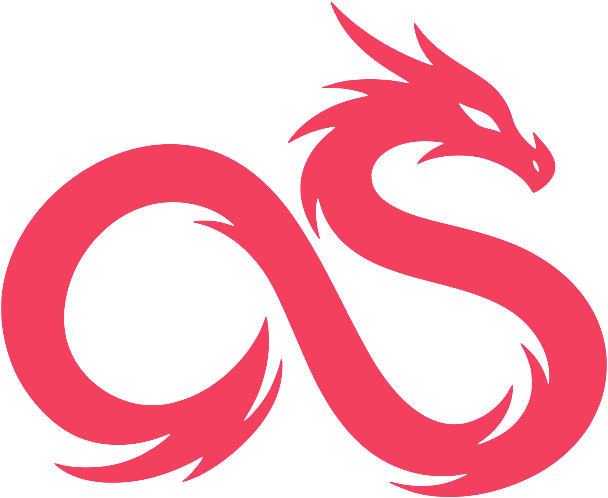

# NginxionS

**Next-Generation Open Source Proxy & Application Security Platform**

Обратный прокси на nginx со встроенной защитой: WAF на машинном обучении, CrowdSec, свой центр сертификации
и mTLS, аналитика трафика и роли. Всё настраивается в одном интерфейсе и работает без облака.

[](https://github.com/opensophy-projects/NPMOS/actions/workflows/ci.yml)
[](https://github.com/opensophy-projects/NPMOS/actions/workflows/security-weekly.yml)
[](https://hub.docker.com/r/opensophy/nginxions)
[](https://github.com/openappsec/openappsec)
[](https://www.crowdsec.net)
[](#принципы)
[](#возможности)

[**Документация**](https://opensophy.com/) · [**Быстрая установка**](#быстрая-установка) · [**Возможности**](#возможности) · [**Контакты**](#безопасность-и-контакты)

<picture>
  <source media="(prefers-color-scheme: dark)" srcset="readme/overview-dark.webp">
  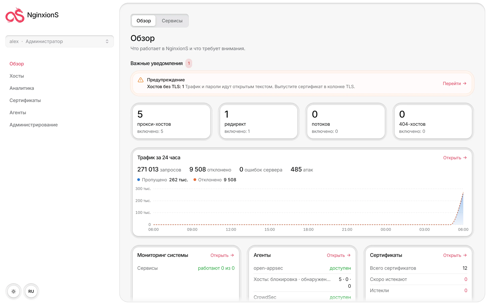
</picture>

</div>

## Быстрая установка

Нужны Linux-сервер с Docker Engine 26+ и Compose 2.23+.

```bash
git clone https://github.com/opensophy-projects/NPMOS nginxions && cd nginxions
docker compose -f deploy/compose.yaml up -d
```

Откройте `https://<адрес-сервера>:81` и зарегистрируйте администратора. Пароли сервисов генерируются
автоматически, `.env` править не нужно. Порты: `80` и `443` для сайтов, `81` для панели.

Подробная установка, обновление и решение проблем — в [документации](https://opensophy.com/).

## Возможности

| | Что умеет | Как выглядит |
|---|---|---|
| **Хосты** | Прокси, редиректы, потоки TCP/UDP и 404-хосты в одной таблице: TLS, WAF, mTLS и доступ каждого хоста видны сразу. Локации, списки доступа, HTTP/2 и HTTP/3, HSTS, проверка доступности upstream, история изменений. | 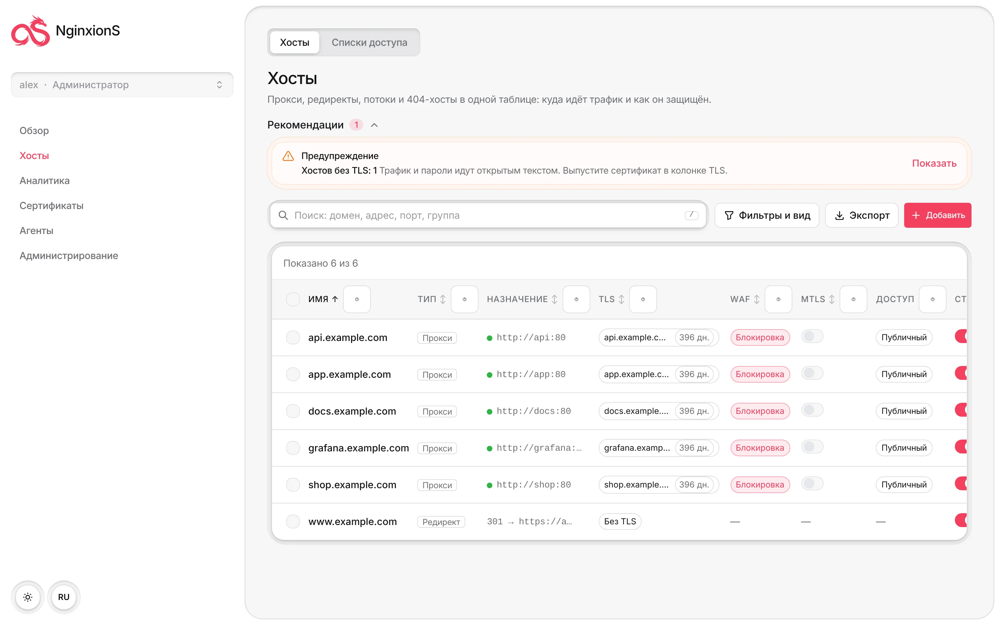 |
| **WAF на машинном обучении** | open-appsec по хостам и локациям: режимы «обучение», «обнаружение» и «блокировка», визуальный редактор политики и YAML, исключения, ограничение частоты запросов, своя страница блокировки. Модель Check Point в комплекте. | 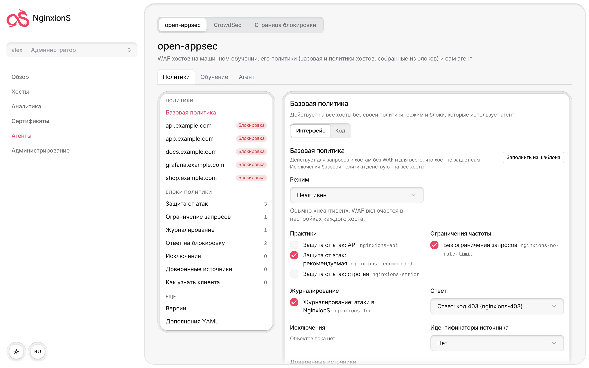 |
| **Обучение агента** | Разметка ложных срабатываний прямо из событий, готовность каждого хоста к режиму блокировки, отмена решений. Настройки агента и fail-open — в интерфейсе. | 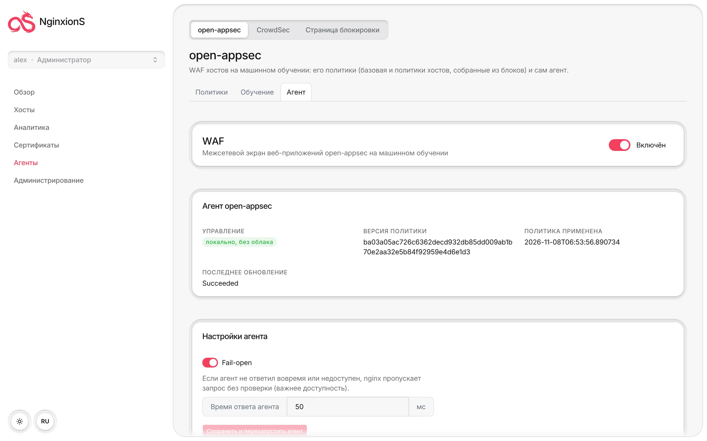 |
| **CrowdSec** | Баны и капча на nginx, сценарии по журналам доступа и событиям WAF, решения, алерты, машины и баунсеры, hub без интернета, блок-листы, белые списки, AppSec. | 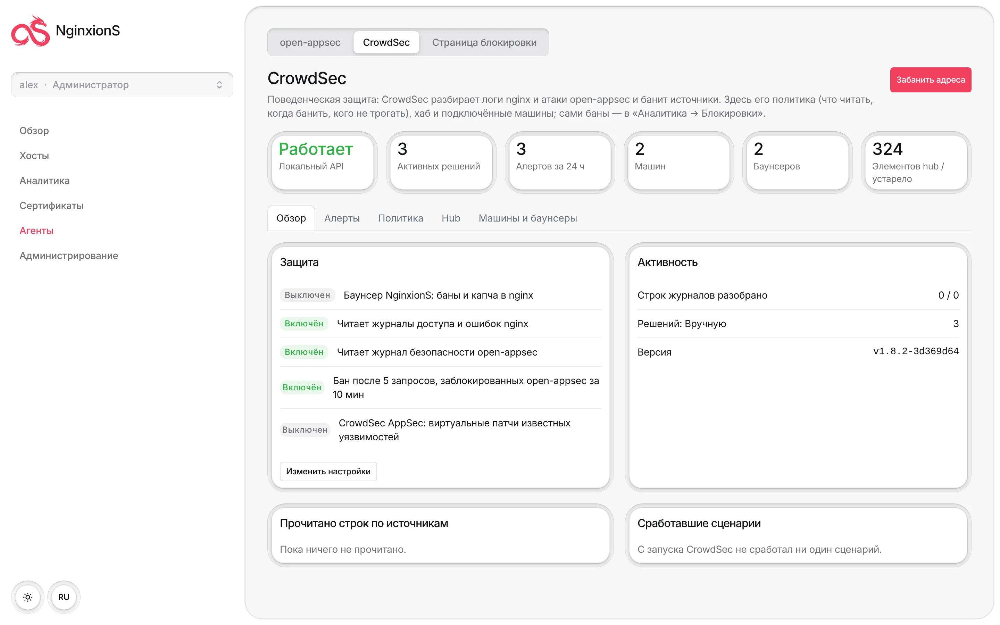 |
| **События** | Атаки open-appsec, баны CrowdSec и отказы mTLS в одной ленте: фильтры, карточка события, экспорт, бан источника или исключение из события в один клик. | 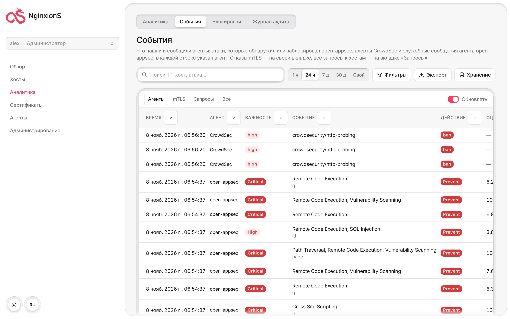 |
| **Аналитика** | Запросы, посетители, производительность, безопасность, кэш и серверы за хостами; периоды от «сейчас» до 30 дней, фильтры по любой строке, журнал запросов. | 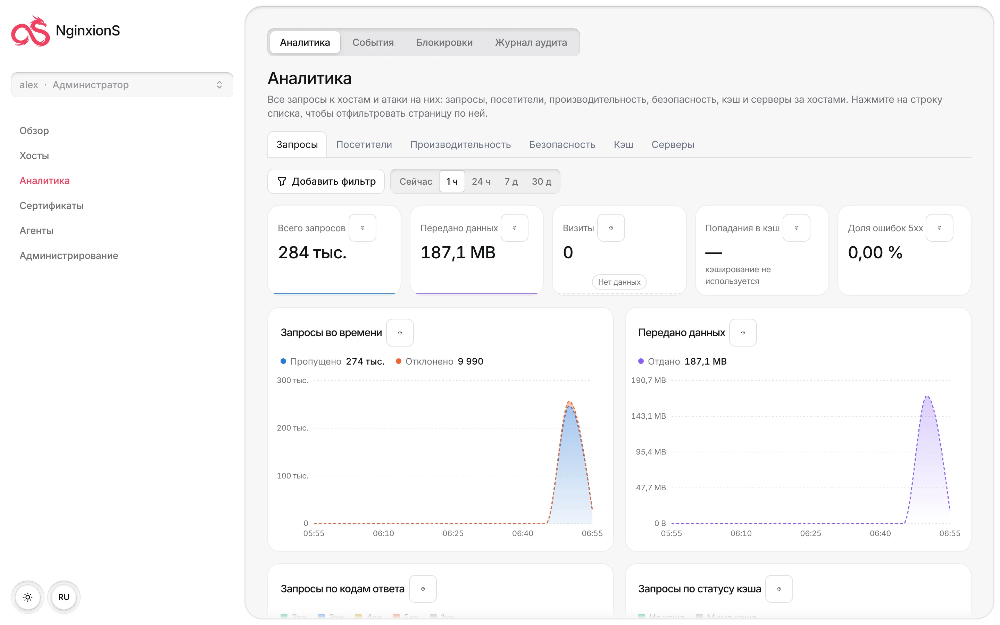 |
| **Сертификаты** | Единый реестр: ACME от любого центра (Let's Encrypt, ZeroSSL, Google Trust Services, SSL.com, свой ACME-сервер), HTTP- и DNS-проверка, свой CSR, клиенты certbot и lego; свои сертификаты; напоминания об истечении. | 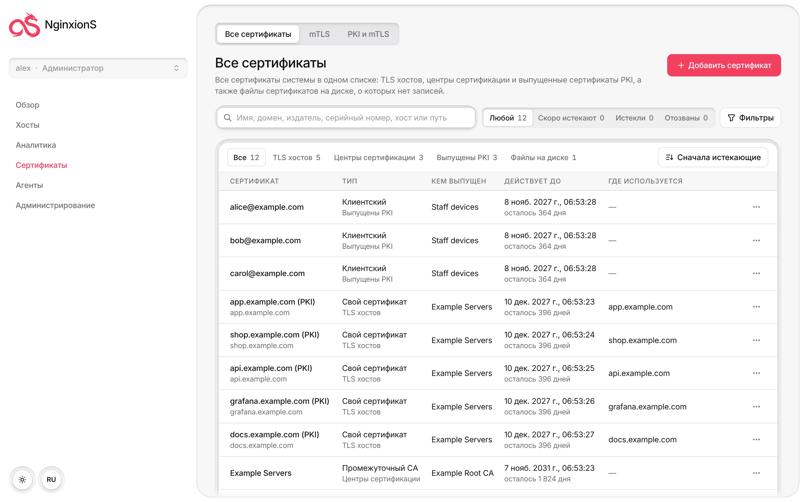 |
| **Свой PKI** | Корневые и промежуточные центры сертификации, серверные и клиентские сертификаты, отзыв, CRL и OCSP, короткоживущие сертификаты с автопродлением, выдача в PEM, PKCS#12, по ссылке и QR. | 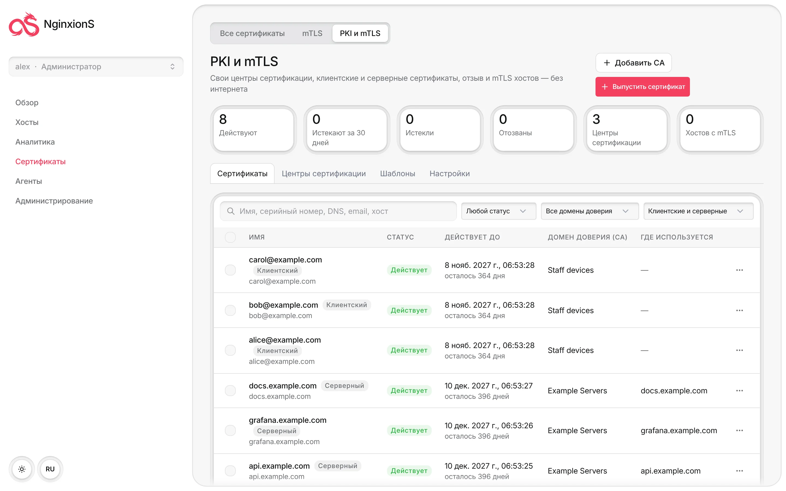 |
| **mTLS** | Защита хоста клиентскими сертификатами одним переключателем: сертификаты доступа по хостам, отзыв действует за минуту, своя страница отказа. | 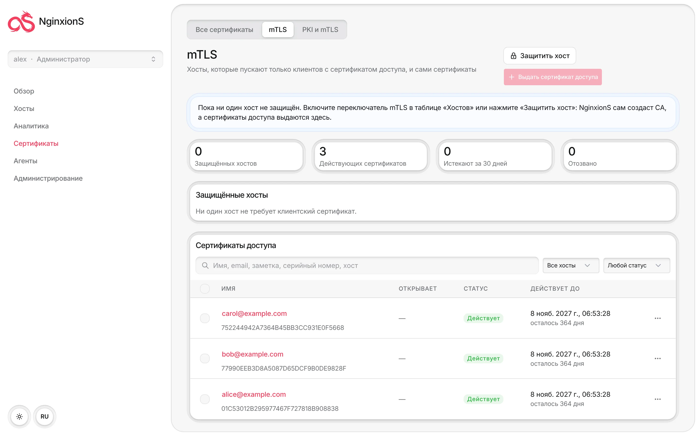 |
| **Роли и аудит** | Встроенные и свои роли, права по разделам и по конкретным хостам, OIDC-группы, двухфакторная аутентификация, журнал аудита всех действий. | 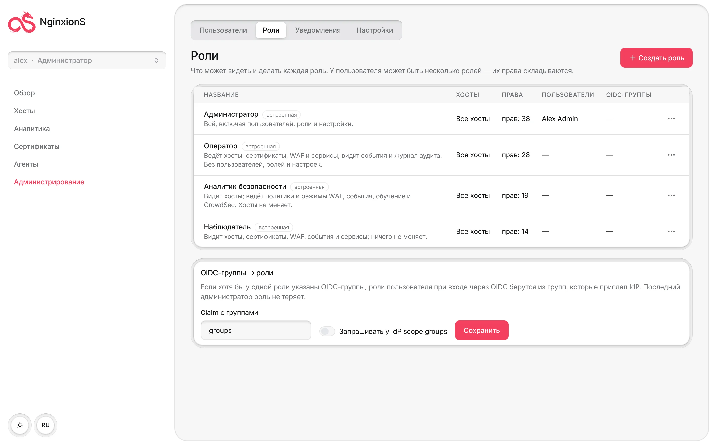 |
| **Уведомления и система** | Email, webhook с подписью HMAC и Telegram по правилам; состояние контейнеров стека, настройки без правки env, GeoIP, перенос с Nginx Proxy Manager и NPMplus. | 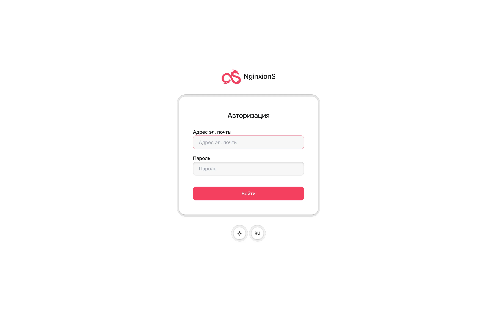 |

## Принципы

1. **Всё в интерфейсе.** После `docker compose up -d` не нужны ни терминал, ни правка файлов, ни `cscli`
   и `open-appsec-ctl`, ни облачные консоли.
2. **Без облака.** open-appsec и CrowdSec работают локально и автономно. Выход в интернет (ACME, hub CrowdSec,
   обновления) — только опция, которую включает администратор, всегда с таймаутом.
3. **Безопасность по умолчанию.** Секреты генерируются при первом запуске, внутренние сервисы сидят в сетях
   без выхода наружу, каждый образ проходит SAST, SCA, скан образов и DAST до публикации.

## Как устроено

Четыре контейнера: `nginxions` (nginx, панель и API), `openappsec` (WAF-агент, его сервисы обучения и
управление стеком), `crowdsec` и `postgres`; при первом запуске один раз отрабатывает `nginxions-init`.
Образы — `opensophy/nginxions` и `opensophy/nginxions-openappsec` на Docker Hub, версии закреплены в
`deploy/.env`. Архитектура — в [CODE_OF_CONDUCT.md](CODE_OF_CONDUCT.md#3-архитектура-nginxions),
разработка — в [CONTRIBUTING.md](CONTRIBUTING.md).

Стек, установленный под старым названием NPMOS, переносится скриптом `scripts/upgrade-from-npmos.sh`
([как](docs/MIGRATION.md#обновление-стека-установленного-под-названием-npmos)).

## Безопасность и контакты

Актуальные контакты, способы сообщить об уязвимости и связаться с командой — на
**[opensophy.com](https://opensophy.com/)**. Пишите туда.

## Благодарности

NginxionS построен на [NPMplus](https://github.com/ZoeyVid/NPMplus) и
[Nginx Proxy Manager](https://github.com/NginxProxyManager/nginx-proxy-manager), использует
[open-appsec](https://github.com/openappsec/openappsec) и [CrowdSec](https://www.crowdsec.net).
